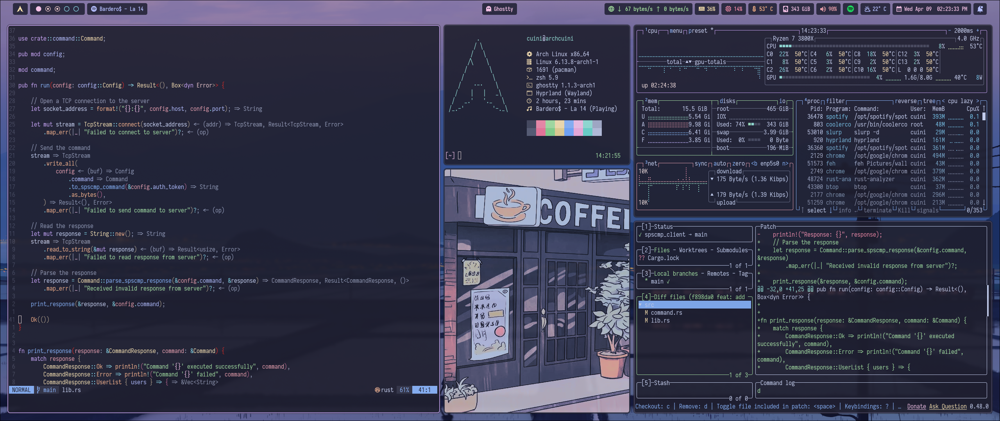
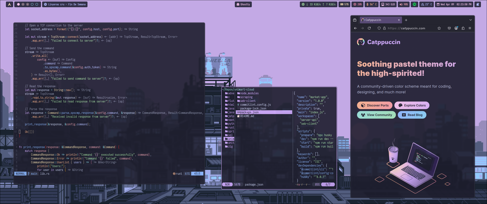
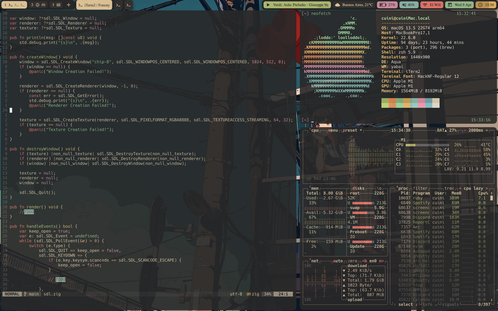

# dotfiles

Personal configurations for my development environment both for `macOS` and `arch`.

## Arch (catpuccin themed)





## Mac (gruvbox themed)




## Considerations

### Arch: setup on a new machine

The repo mirrors `$HOME`: every top-level directory is one app, so `hyprland/.config/hypr`
becomes `~/.config/hypr`, `git/.gitconfig` becomes `~/.gitconfig`, `scripts/.local/bin` becomes
`~/.local/bin`, etc. Link it into place with GNU `stow` (what this machine does today, with
hand-made symlinks that resolve to the same targets):

```bash
# deps: hyprland (tested on 0.56.2, lua config), quickshell, matugen, kitty, zsh, stow, ...
git clone <this repo> ~/dotfiles && cd ~/dotfiles

APPS="hyprland hyprlock hyprpaper kitty quickshell zsh neovim git yazi tmux matugen
      pi opencode television fastfetch firefox zathura spicetify wireplumber scripts"

stow -n -v -t ~ $APPS    # dry run: shows every link it would create
stow -t ~ $APPS          # apply
```

### Arch: machine-local files (do this first)

Anything hardware- or machine-specific lives in a gitignored `*.local.*` / `machine.json` file
that you create yourself; the versioned code reads it and never hardcodes output names, device
names or paths. Each one ships a `.sample` next to it.

| Create this | From | What goes in it |
|---|---|---|
| `~/.config/hypr/modules/hardware/monitors.local.lua` | `monitors.local.lua.sample` | monitors, workspace-per-monitor rules, `agents_monitor` fact. See [hyprland/README.md](hyprland/README.md) |
| `~/.config/hypr/modules/hardware/input.local.lua` | `input.local.lua.sample` | keyboard/mouse/touchpad device names (`hyprctl devices`) |
| `~/.config/quickshell/machine.json` | `machine.json.sample` | which screen the bar/panels live on, `agentsMonitor`, icon sizes. Optional (defaults to the first screen). See [quickshell/README.md](quickshell/README.md) |
| `~/.config/zsh/environment/variables.local.zsh` | `variables.local.zsh.sample` | machine-specific env vars and `PATH` entries. See [zsh/README.md](zsh/README.md) |

Layout of the rest:

- `hyprland/` — Lua config for Hyprland (binds, rules, monitors, autostart)
- `quickshell/` — QtQuick bar, panels and widgets
- `matugen/` — generates the color palette from the wallpaper (see [matugen/README.md](matugen/README.md))
- `kitty/`, `zsh/`, `neovim/`, `tmux/`, `yazi/`, `firefox/`, `pi/`, `opencode/`, ... — one dir per app

### Arch: generated files (don't hand-edit)

`matugen` rewrites the palette from the current wallpaper, including
`hyprland/.config/hypr/modules/colors/colors.lua` and `quickshell/.config/quickshell/style/colors.json`,
plus btop/kitty/tmux/gtk/... — the full list is in `matugen/.config/matugen/config.toml`.
Kick it with `set-theme` (see [matugen/README.md](matugen/README.md) for the `dank-gen` binary).

After changing the Hyprland side: `hyprctl reload` (Quickshell hot-reloads its QML).

### Backends / other notes

Some `macOS` configurations conflict with the ones used for `arch`. Use the `mac` branch to override the `arch` settings.

For `hyprpanel` weather module a [weatherapi](https://www.weatherapi.com/) api key is needed. See [here](https://www.weatherapi.com/). 
The current config expects one in the `hyprpanel` config directory.

For `sketchybar` weather module a [weatherapi](https://www.weatherapi.com/) api key is also needed. 
Create a file called `weather.env.sh` in `.config/sketchybar/scripts` that defines two variables:
- **KEY**: which should be your **API** key
- **CITY**: which is the city to show the weather for.

See more details [here](https://github.com/CriticalElement/dotfiles). 

## Credits

- [gh0stzk/dotfiles](https://github.com/gh0stzk/dotfiles) (old bspwm config)
- [LierB/fastfetch](https://github.com/LierB/fastfetch) (arch fetch preset)
- [mac rice](https://www.reddit.com/r/unixporn/comments/jupmda/aquayabai_a_fun_colorful_rice_to_brighten_my/) (mac rice inspiration)
- [adi1090x/rofi](https://github.com/adi1090x/rofi?tab=readme-ov-file) (rofi theme inspiration)
- [pivoshenko](https://github.com/pivoshenko/catppuccin-startpage) (arch firefox startpage)
- [ninepointeight](https://codeberg.org/nine_point_eight/config-files) (mac firefox startpage)
- [CriticalElement](https://github.com/CriticalElement/dotfiles) (mac status bar inspiration)
